# HƯỚNG DẪN SỬ DỤNG ULMS

Dành cho **bạn đọc** (sinh viên, học viên, cán bộ) và **nhân viên thư viện** (N1 Mượn trả, N2 Xử lý vi phạm, N3 Kho sách, N4 Quản trị).
Ảnh chụp lấy từ dữ liệu mẫu; tên trường, địa chỉ, số liệu trên hệ thống thật sẽ khác. Ảnh đầy đủ (máy tính và điện thoại) ở
[`anh_giao_dien/`](anh_giao_dien/DANH_SACH_ANH.md).

- Cổng bạn đọc: `https://<địa chỉ thư viện>/`
- Hệ thống nghiệp vụ (nhân viên): `https://<địa chỉ thư viện>/quan-tri/dang-nhap`

Mọi trang dùng được trên điện thoại. Người dùng bật “giảm chuyển động” trong hệ điều hành thì hiệu ứng được thay bằng chuyển cảnh mờ ngắn.

---

## Phần A – Bạn đọc

### A1. Trang chủ

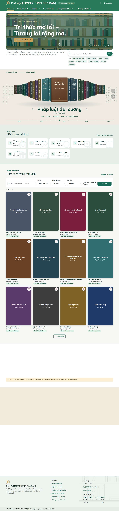

| Khu | Dùng để |
|---|---|
| Thanh tìm kiếm trên ảnh lớn | Gõ tên sách, tác giả, ISBN hoặc từ khóa – **không cần gõ dấu** (“lap trinh” tìm được “Lập trình”). Bấm một gợi ý để tìm nhanh |
| Kệ sách nổi bật | Lướt kệ bằng nút ← →, phím mũi tên, kéo chuột, cuộn ngang hoặc vuốt (điện thoại). Đổi kệ: Sách mới về, Mượn nhiều nhất, từng thể loại. Bấm cuốn giữa để mở sách |
| Danh mục | Bấm một thể loại → khu Khám phá sách lọc theo thể loại đó |
| Khám phá sách | Lọc thể loại, năm xuất bản, “chỉ sách còn có thể mượn”, sắp xếp; “Xem thêm” để tải tiếp |
| Hướng dẫn | Tóm tắt quy định mượn, đặt chỗ, gia hạn, trả – đầy đủ ở trang `/huong-dan` |
| Thông tin thư viện, chân trang | Giờ mở cửa (hôm nay in đậm), địa chỉ, điện thoại, email, nội quy |

Menu trên cùng: rê chuột (hoặc Tab tới rồi nhấn ↓) vào **Danh mục** / **Hướng dẫn mượn sách** để mở menu con; trên điện thoại bấm
nút ☰ rồi bấm tên nhóm để mở/thu gọn.

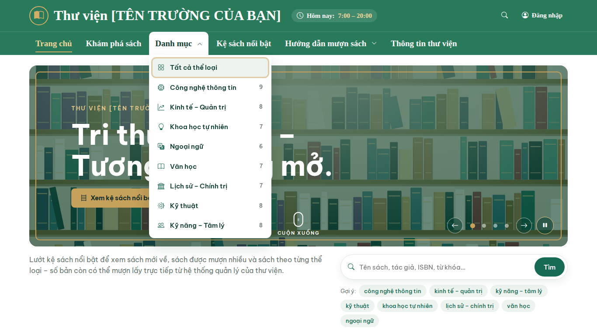

### A2. Kích hoạt tài khoản

Thư viện tạo tài khoản cổng khi cấp thẻ. Lần đầu: vào **Đăng nhập → Kích hoạt tài khoản** (`/kich-hoat`), nhập mã sinh viên/học viên/cán bộ,
số thẻ bạn đọc, ngày sinh và đặt mật khẩu (≥ 8 ký tự, có chữ và số). Quên mật khẩu: dùng cùng trang này để đặt lại.
Nhập sai 5 lần liên tiếp thì bị khóa tạm 15 phút.

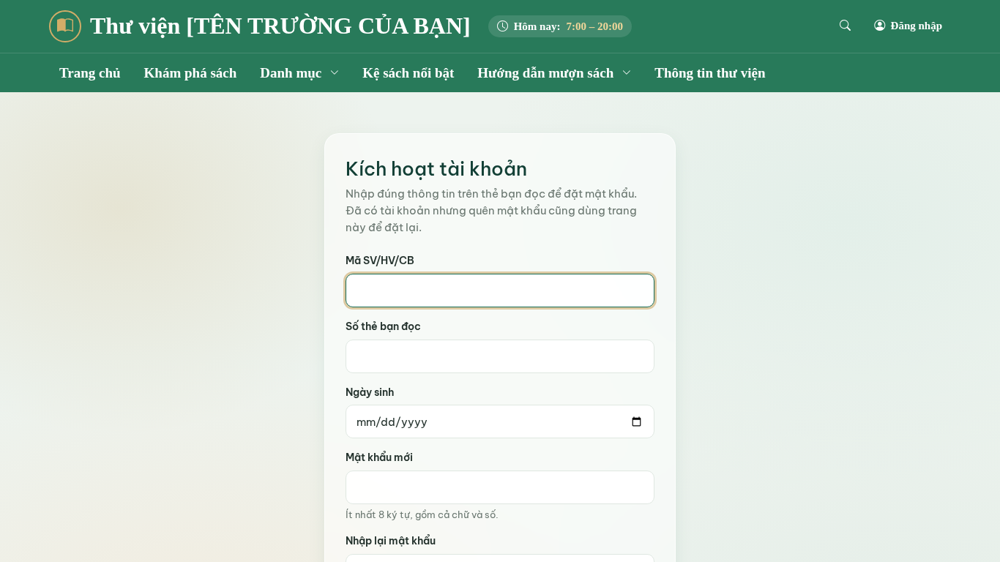

### A3. Xem sách và đặt chỗ giữ sách 24 giờ

1. Bấm vào một cuốn sách (trên kệ hoặc trong Khám phá sách) → trang sách mở ra dạng sách lật: thông tin, số bản còn trên kệ, vị trí.
2. Bấm **Đặt chỗ**. Chưa đăng nhập thì đăng nhập ngay trong trang sách, hệ thống tự đặt chỗ tiếp.
3. Thành công: hiện **vé giữ chỗ** có mã đặt chỗ, mã vạch, đồng hồ đếm ngược 24 giờ.
4. Mang thẻ bạn đọc tới quầy trong 24 giờ – nhân viên quét mã/nhập mã để cho mượn. Quá 24 giờ, đặt chỗ tự hết hạn, sách trở lại cho người khác mượn.

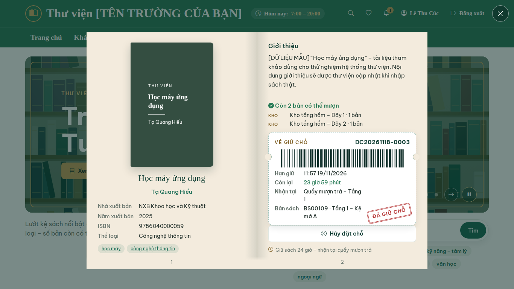

Không đặt được khi: thẻ hết hạn, đang có sách quá hạn hoặc khoản phạt chưa nộp, đã đạt số bản tối đa (tính cả sách đang giữ chỗ),
đã giữ đủ 3 đặt chỗ, đã giữ cuốn này, hoặc hết bản trên kệ. Trang sách ghi rõ lý do và cách xử lý.

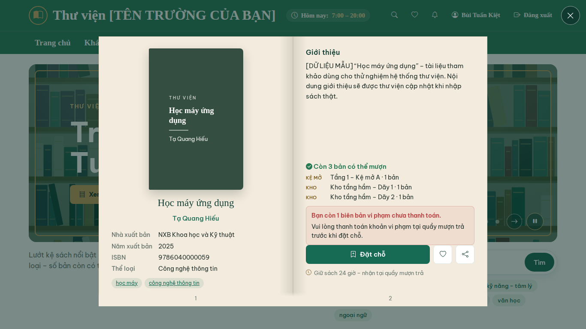

### A4. Trang cá nhân (`/tai-khoan`)

| Trang | Nội dung |
|---|---|
| Tổng quan | Số sách đang mượn, sắp đến hạn, đặt chỗ, biểu đồ lượt mượn 12 tháng |
| Sách đang mượn | Hạn trả, số ngày còn lại / quá hạn |
| Đặt chỗ | Vé giữ chỗ đang hiệu lực (hủy được), lịch sử đặt chỗ |
| Lịch sử | Các lần mượn trả theo năm |
| Vi phạm và khoản phải nộp | Biên bản, số tiền, đã/chưa thanh toán |
| Yêu thích | Sách đã bấm tim |
| Thông báo | Nhắc sắp hết hạn giữ chỗ, sắp đến hạn trả, quá hạn… (chuông trên đầu trang hiện số chưa đọc) |
| Đổi mật khẩu | |

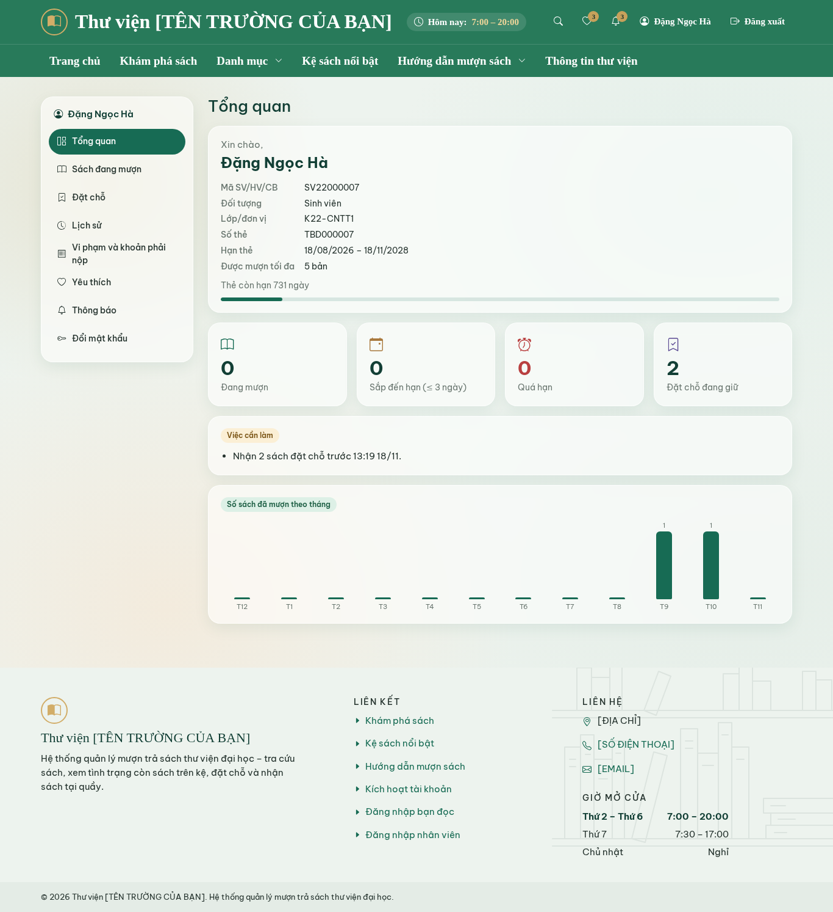

---

## Phần B – Nhân viên

### B1. Đăng nhập, giao diện chung (6.3.1)

Nhập tên đăng nhập, mật khẩu → **Đăng nhập**. Sai 5 lần liên tiếp tài khoản bị khóa, nhờ N4 mở khóa. Mỗi nhóm chỉ thấy menu của mình
và mở thẳng màn hình hay dùng nhất. Phiên làm việc tự hết sau 30 phút không thao tác.

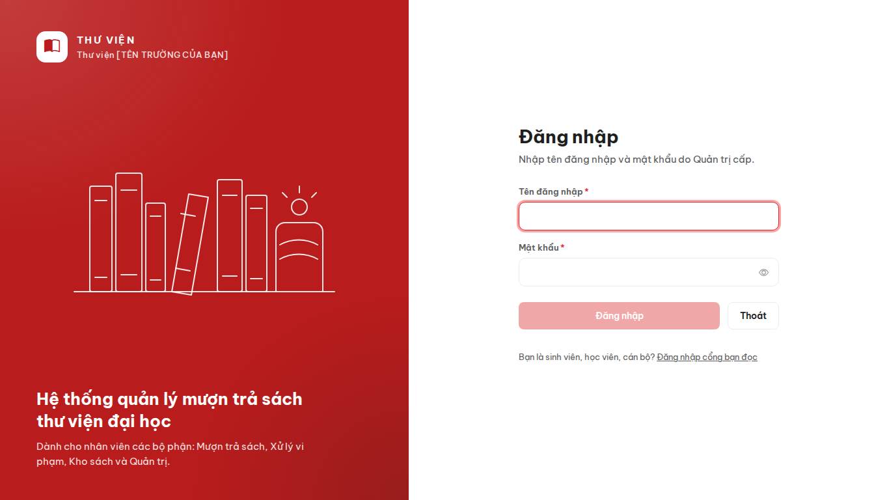

- Menu bên trái (điện thoại: nút ☰). Trang **Tổng quan** của mỗi nhóm có chỉ số và biểu đồ; bấm chỉ số để xem danh sách chi tiết.
- Lưới dữ liệu: tìm, sắp xếp, phân trang. Các nút bật/tắt theo trạng thái màn hình (đúng đặc tả) – nút mờ là chưa dùng được ở bước đó.
- Thông báo lỗi hiện ngay cạnh ô nhập, kèm hướng xử lý.

### B2. N1 – Mượn trả sách

**Lập Phiếu mượn sách (01.01.03)**

1. Nhập mã sinh viên/học viên/cán bộ → **Tìm bạn đọc**: hệ thống kiểm tra điều kiện mượn (thẻ còn hạn, không có sách quá hạn,
   không có biên bản chưa thanh toán, chưa vượt số bản tối đa).
2. Nhập mã bản sách → **Thêm sách** (lặp cho từng bản). Bạn đọc có đặt chỗ: khối **Đặt chỗ** hiện các bản đang giữ, bấm **Nhận đặt chỗ** để
   đưa vào phiếu.
3. **In** → hệ thống cấp số phiếu `PMyyMM####`, lưu và mở mẫu in MB02. Bạn đọc đã có phiếu lập trong ngày thì sách được bổ sung vào phiếu đó.
4. Sửa phiếu đã lưu: nhập số phiếu → **Tìm phiếu**. **Hủy** để làm lại, không tốn số phiếu.

| Trạng thái 1 – tìm bạn đọc | Trạng thái 2 – thêm sách |
|---|---|
| 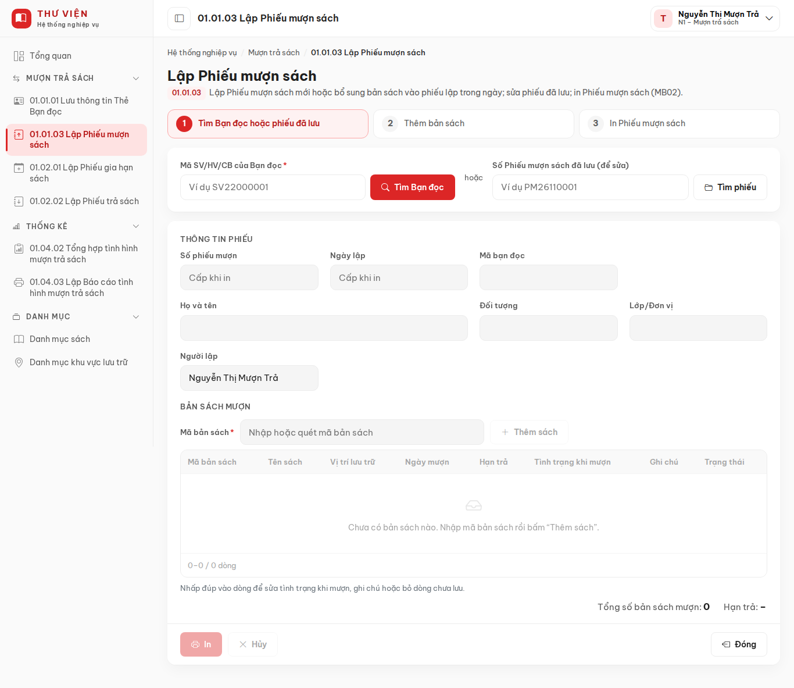 | 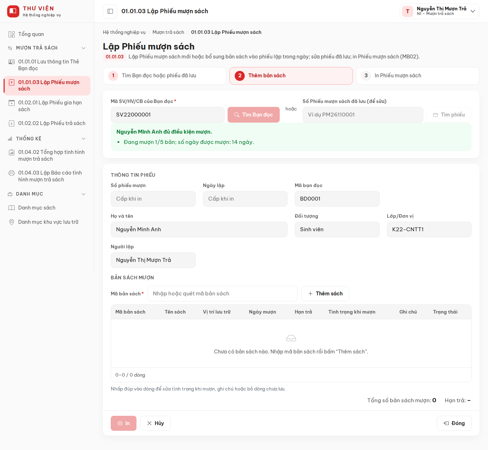 |

**Lập Phiếu gia hạn (01.02.01)**: nhập số phiếu mượn → chọn bản sách, ngày đề nghị → hệ thống tính hạn mới (thêm 7 ngày, mỗi bản tối đa
1 lần) hoặc lý do không gia hạn → **In** (MB03).

**Lập Phiếu trả (01.02.02)**: nhập số phiếu mượn → chọn bản trả, tình trạng (Bình thường / Hư hỏng / Mất) → hệ thống tính số ngày quá hạn,
đánh dấu trường hợp vi phạm → **In** (MB04). Trường hợp vi phạm tự chuyển sang N2.

**Quầy đặt chỗ**: danh sách đặt chỗ đang giữ (đếm ngược), lọc, hủy có lý do, in **phiếu soạn sách** để lấy sách từ kệ chuẩn bị trước.

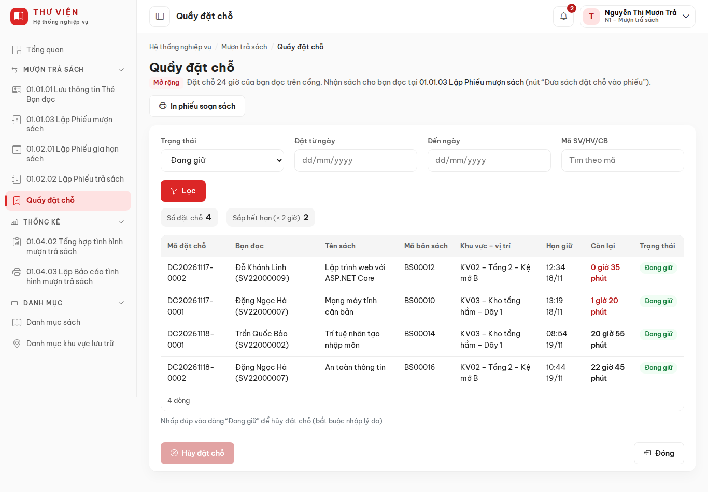

**Danh mục Bạn đọc (6.1.3)**: tìm, thêm (tự tạo tài khoản cổng chờ kích hoạt), sửa, kiểm tra điều kiện mượn, ảnh thẻ.

**Báo cáo mượn trả (MB06)**: chọn kỳ → **Tổng hợp** → xem trước → **Lập báo cáo** / **In**. Khi xem trước, số liệu tổng hợp và biểu đồ tính trên toàn kỳ; bảng chi tiết dài hơn 50 dòng được chia trang (50 dòng/trang, nút trang dưới bảng). Bản in luôn đủ mọi dòng của kỳ.

### B3. N2 – Xử lý vi phạm

**Lập Biên bản vi phạm (02.03.01)**: nhập số phiếu mượn của trường hợp vi phạm (danh sách chờ xử lý ở trang Tổng quan N2) → chọn khoản thu,
bản sách, số lượng → **Thêm** (thành tiền = số lượng × đơn giá, tổng tiền tự cộng) → chọn hình thức thanh toán → **In** (MB05).
Sách mất/hư hỏng tự chuyển cho N3.

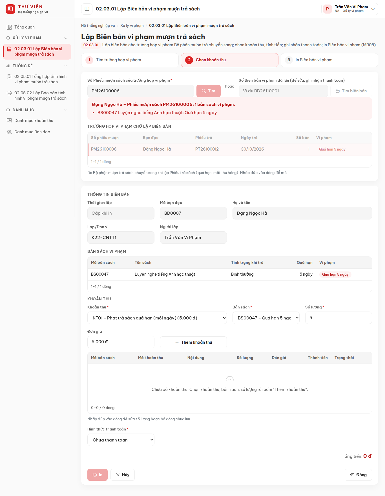

**Danh mục khoản thu (6.1.2)**, **Báo cáo vi phạm (MB07)**: tương tự MB06 (bảng bạn đọc vi phạm chia trang 50 dòng khi xem trước, bản in đủ dòng).

### B4. N3 – Kho sách

- **Danh mục sách (6.1.1)**: thêm/sửa bản sách, lọc theo tình trạng, thống kê số sách theo tình trạng. Lưới **Sách chuyển đến** liệt kê sách
  vừa cho mượn/trả/mất/hư hỏng cần cập nhật tình trạng – chọn dòng → cập nhật (03.01.04, 03.03.02…).
- **Danh mục khu vực (6.1.4)**: khu vực còn sách thì không xóa được.
- **Quản lý đầu sách**, **Quản lý thể loại** (cổng bạn đọc): thông tin giới thiệu, từ khóa, ảnh bìa (tự chuyển WebP, tối đa 2 MB), gắn các bản
  sách vào đầu sách – đây là dữ liệu hiển thị trên kệ sách và trang sách của bạn đọc.

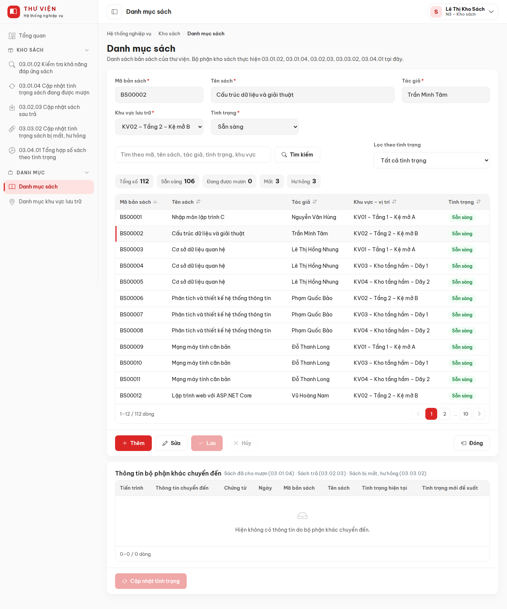

### B5. N4 – Quản trị hệ thống

| Màn hình | Thao tác chính |
|---|---|
| 04.00.01 Quản lý tài khoản | Thêm (mật khẩu mặc định `Thuvien@123`), sửa, khóa/mở khóa, đặt lại mật khẩu. Không tự khóa chính mình |
| 04.00.02 Cấp quyền | Chọn nhóm → tích quyền → **Lưu**; có hoàn tác. Không bỏ được quyền quản trị của N4 |
| 04.00.03 / 04.00.08 Nhật ký | Lịch sử đăng nhập, hoạt động; lọc theo khoảng ngày, người dùng |
| 04.00.09 Sao lưu – phục hồi | Chọn thư mục → **Sao lưu**; phục hồi: chọn tệp, xác nhận 2 lần – mọi người khác bị đăng xuất |
| Danh mục Bạn đọc – tài khoản cổng | Khóa/mở khóa tài khoản cổng của bạn đọc |

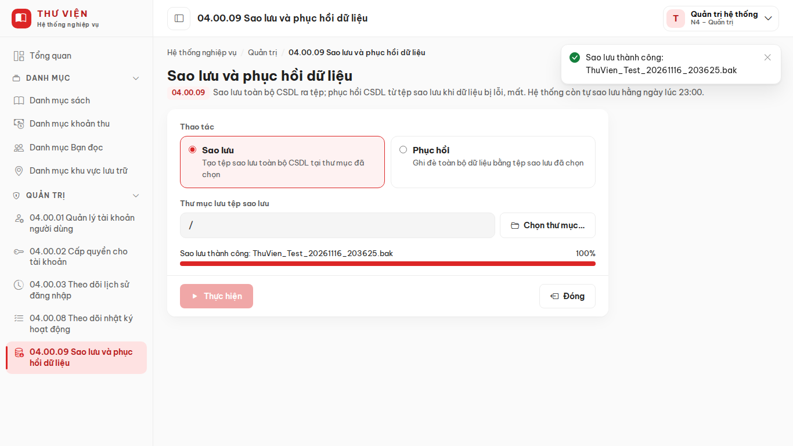

Lần đăng nhập đầu tiên của `admin` trên hệ thống thật, hệ thống bắt đổi mật khẩu.

---

## Phần C – Câu hỏi thường gặp

| Câu hỏi | Trả lời |
|---|---|
| Bạn đọc quên mật khẩu? | Tự đặt lại ở `/kich-hoat` (cần mã SV, số thẻ, ngày sinh), hoặc nhờ thư viện |
| Nhân viên bị khóa do nhập sai? | N4 mở khóa ở 04.00.01 |
| Sách vừa có người đặt trước, bạn đọc khác đến quầy? | Bản đang giữ chỗ không cho người khác mượn; hệ thống chọn bản khác trên kệ nếu còn |
| Đặt chỗ hết hạn lúc nào? | Đúng 24 giờ sau khi đặt; hệ thống nhắc trước 2 giờ và tự chuyển “Hết hạn” |
| In bị lệch khổ giấy? | Mẫu MB02–MB04 khổ A5; MB05 (2 bản), MB06–MB07 và phiếu soạn sách khổ A4 – chọn đúng khổ, lề mặc định trong hộp thoại in |
